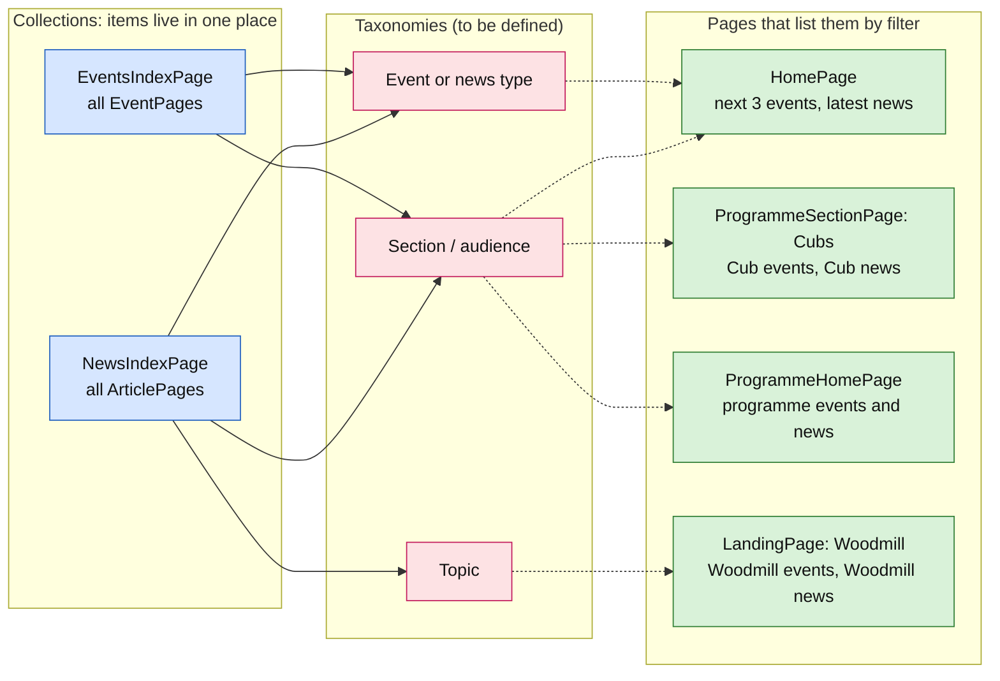
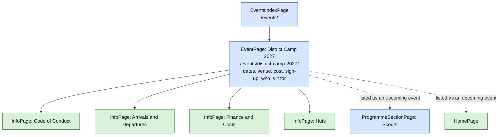

# Example structures

Illustrative structures for the target page types in [page-types.md](page-types.md), using the Southampton City
District content as the example. They show where things would live. Page titles are examples, and a Group or county
site would populate the same types differently.

Colour key: **green** exists unchanged · **amber** reworked · **blue** new, design agreed · **grey dashed**
planned, not designed.

## 1. Example page tree

```mermaid
flowchart TD
    classDef exists fill:#d9f2d9,stroke:#2e7d32,color:#111
    classDef rework fill:#fff3cd,stroke:#b58900,color:#111
    classDef new fill:#d6e6ff,stroke:#1f5fbf,color:#111
    classDef planned fill:#eeeeee,stroke:#888,stroke-dasharray:5 4,color:#333

    Home["HomePage<br/>Volunteer Hub"]:::exists

    %% News
    News["NewsIndexPage<br/>News"]:::exists
    A1["ArticlePage<br/>June 2025 Update"]:::exists
    A2["ArticlePage<br/>Storm Ciarán"]:::exists
    Home --> News --> A1
    News --> A2

    %% Events
    Events["EventsIndexPage<br/>What's on"]:::new
    E1["EventPage<br/>District Camp 2027"]:::new
    E1a["InfoPage<br/>Code of Conduct"]:::exists
    E1b["InfoPage<br/>Arrivals and Departures"]:::exists
    E1c["InfoPage<br/>Finance and Costs"]:::exists
    E2["EventPage<br/>District AGM"]:::new
    E3["EventPage<br/>Christmas Campfire"]:::new
    Home --> Events
    Events --> E1 --> E1a
    E1 --> E1b
    E1 --> E1c
    Events --> E2
    Events --> E3

    %% Programme
    Prog["ProgrammeHomePage<br/>Programme"]:::new
    S1["ProgrammeSectionPage<br/>Squirrels"]:::new
    S2["ProgrammeSectionPage<br/>Beavers"]:::new
    S3["ProgrammeSectionPage<br/>Cubs"]:::new
    S4["ProgrammeSectionPage<br/>Scouts"]:::new
    P1["InfoPage<br/>Nights Away Permits"]:::exists
    P2["InfoPage<br/>Top Awards"]:::exists
    P3["ProcessPage<br/>Apply for a Nights Away Permit"]:::rework
    S3a["InfoPage<br/>Cub programme ideas"]:::exists
    Home --> Prog
    Prog --> S1
    Prog --> S2
    Prog --> S3 --> S3a
    Prog --> S4
    Prog --> P1 --> P3
    Prog --> P2

    %% Support hubs and wikis
    Support["LandingPage<br/>Support"]:::exists
    Dig["LandingPage<br/>Digital Services"]:::exists
    Wiki["IndexPage<br/>Digital Team Wiki"]:::exists
    W1["InfoPage<br/>Domain Names"]:::exists
    W2["ProcessPage<br/>Send District Emails"]:::rework
    Woodmill["LandingPage<br/>Woodmill Outdoor Centre"]:::exists
    Map["GISPage<br/>Woodmill Map"]:::exists
    Book["LandingPage<br/>Bookings Wiki"]:::exists
    B1["InfoPage<br/>Pricing and Discounts"]:::exists
    B2["ProcessPage<br/>Invoice a Booking"]:::rework
    Sup["DirectoryPage<br/>Supplier Directory"]:::new
    Home --> Support
    Support --> Dig --> Wiki
    Wiki --> W1
    Wiki --> W2
    Support --> Woodmill
    Woodmill --> Map
    Woodmill --> Book
    Book --> B1
    Book --> B2
    Support --> Sup

    %% Governance, people
    Gov["IndexPage<br/>Governance"]:::exists
    Rep["InfoPage<br/>District AGM Reports"]:::exists
    Team["PersonListingPage<br/>Meet the District Team"]:::rework
    Home --> Gov --> Rep
    Home --> Team

    %% Planned
    Pol["Policies<br/>Accounts, Lone Worker, ..."]:::planned
    Roles["Roles and vacancies<br/>Volunteer Opportunities"]:::planned
    Home -.-> Pol
    Home -.-> Roles
```

Notes on this tree:

- **District Camp 2027** becomes an `EventPage` whose existing sub-pages are kept as its children, rather than a
  Landing page under Programme.
- **Programme** gains a proper home. The age-section pages become `ProgrammeSectionPage`s, and
  programme-wide tools (nights away permits, top awards) sit beside them.
- **Support** stays a curated Landing page and keeps the departmental wikis (Digital, Woodmill) as they are, with
  Index and Process pages inside.
- **Suppliers** move out of a long Info page into a `DirectoryPage`. They would also fit under Woodmill if only
  Woodmill uses them. Placement is an editorial call.
- The tree is shown with the district's pages; a Group or county site would populate the same types differently.

## 2. How collection items appear on other pages

Because every event, article and (later) policy or role lives in one place, other pages show them as filtered
listings instead of copies. The filter dimensions are placeholders until the taxonomies are decided.

Reading the diagram: an item is classified once (solid lines into taxonomies). Each host page declares which values
it wants (dotted lines), and shows the matching items with a "see all" link to the collection index, pre-filtered
the same way. This is how recent news already works on the home and landing pages, extended to events.

## 3. A multi-page event as a hub

How District Camp 2027 would look to a visitor and to the tree, since this is the case that decided "events live
only under the Events index".

The trade-off to be aware of: the camp's URL is `/events/district-camp-2027/...` rather than under Programme. In
return there is one list of what's on, and the camp appears on every page whose filter matches it.
